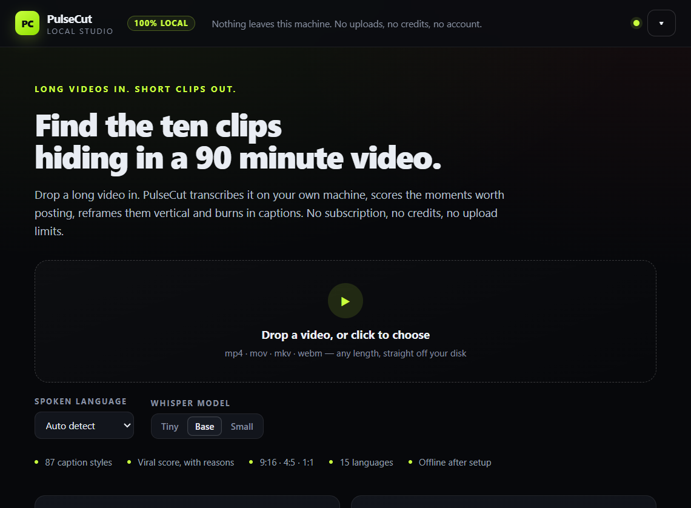
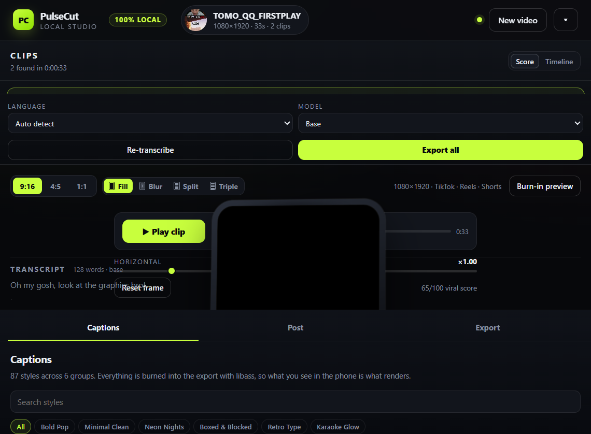
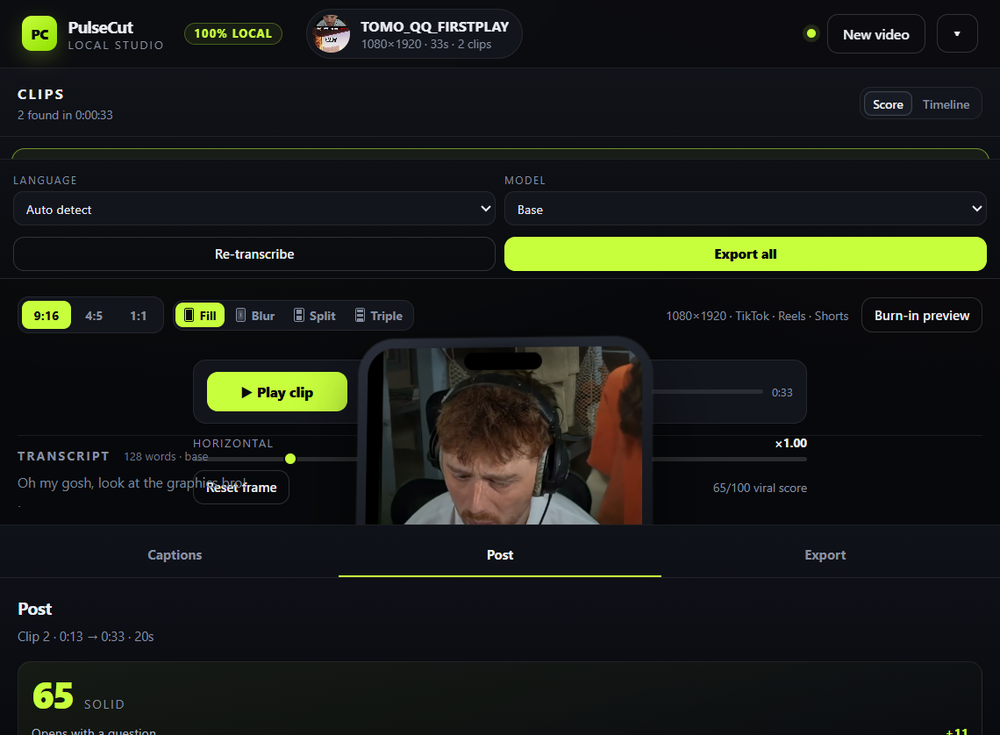
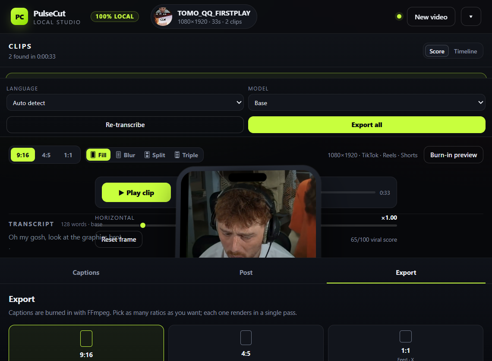

# PulseCut

**Long videos in. Short clips out.**

PulseCut is a local-first studio that turns a long video into vertical, captioned clips ready for TikTok, Reels and Shorts. Drop a file, and the app transcribes it with Whisper **on your own machine**, finds the moments worth posting, lets you restyle the captions and framing, and renders finished MP4s with FFmpeg. Nothing is uploaded, there are no credits, and there is no account.



## Screenshots

| Studio | Post details | Export queue |
| --- | --- | --- |
|  |  |  |

## Features

- **100% local pipeline** — audio extraction with FFmpeg, speech recognition with Whisper through `@huggingface/transformers` (ONNX runtime). Models are cached in `data/models/` after the first download, so later runs work offline.
- **Automatic moment detection** — scores up to 8 candidate clips from the transcript using hooks, pacing, completeness and word density, with human-readable reasons for each score.
- **Editable clips** — trim start/end times, rewrite titles and hashtags, and nudge the subject position/zoom for every clip.
- **Live phone preview** — scrub a clip in a 9:16, 4:5 or 1:1 frame before rendering. Four video layouts: Fill, Blur, Split and Triple.
- **87 caption styles** across 6 families (Bold Pop, Minimal Clean, Neon Nights, Boxed & Blocked, Retro Type, Karaoke Glow), with font, colour, size, position, opacity and tilt controls.
- **15 languages**, including auto-detect, English, Hindi, Urdu, Hinglish, Spanish, French, German, Portuguese, Arabic, Turkish, Indonesian, Bengali, Tamil and Russian.
- **Three Whisper model sizes** — Tiny (~75 MB), Base (~145 MB, recommended) and Small (~480 MB).
- **Batch export** — render one clip or all clips in one pass, in any combination of 9:16 (1080×1920), 4:5 (1080×1350) and 1:1 (1080×1080). Captions are burned in, an outro is appended, and finished files are downloadable from the Export panel.
- **Production build included** — the compiled front end lives in `dist/` and can be served by the Express API with `npm start`.

## Tech stack

| Layer | Tools |
| --- | --- |
| Front end | React 18, Vite 6, plain CSS |
| Back end | Express 4, Multer, SSE progress events |
| Media | FFmpeg (video/audio extraction, filtering, rendering), ffprobe via `@ffprobe-installer/ffprobe` |
| Speech | `@huggingface/transformers` with local Xenova Whisper models |
| Packaging | `@ffmpeg-installer/ffmpeg` fallback binary, `concurrently` for local dev |

## Requirements

- **Node.js 20 or newer** and npm.
- **FFmpeg + ffprobe.** You have three options:
  1. Install them on your `PATH`.
  2. Set `FFMPEG_PATH` / `FFPROBE_PATH` to the executables you want to use.
  3. Do nothing — the app auto-detects `imageio-ffmpeg` (if Python has it) and otherwise falls back to the npm-bundled `@ffmpeg-installer/ffmpeg` binary. ffprobe is bundled via `@ffprobe-installer/ffprobe`.

The first transcription downloads a Whisper model once (up to ~480 MB for `small`); after that, no network access is needed.

## Quick start

```bash
git clone https://github.com/juxPapi/pulsecut.git
cd pulsecut
npm install
npm run dev
```

Open **http://localhost:5190**. `npm run dev` starts both processes:

- Vite dev server on `http://localhost:5190` (proxies `/api` and `/media` to port 8790)
- Express API on `http://127.0.0.1:8790`

PulseCut uses ports 5190/8790 so it never collides with other local apps that use 5173/8787.

## Production build

```bash
npm install
npm run build     # compiles the React app into dist/
npm start         # Express serves dist/ and the API on PORT (default 8790)
```

Then open **http://localhost:8790**. The compiled `dist/` bundle is committed in this repository, so `npm start` works immediately after install.

## How to use it

1. **Import** — drop an MP4/MOV/MKV/WebM file (up to 8 GB), choose the spoken language and Whisper model, then let transcription run. Progress and logs stream live.
2. **Pick clips** — the left rail lists scored moments. Select one to load it into the phone preview.
3. **Style** — choose a caption style, adjust size/position/opacity, and switch the video layout.
4. **Post** — edit the clip title, hashtags, focus point and zoom.
5. **Export** — select one or more aspect ratios, render a single clip or all clips, and download the MP4s.

If Whisper struggles with a language or accent, you can paste a transcript manually; PulseCut will score clip moments from it without running speech recognition.

## Configuration

| Variable | Default | Purpose |
| --- | --- | --- |
| `PORT` | `8790` | Express API / production server port |
| `FFMPEG_PATH` | auto-detected | Override the FFmpeg executable |
| `FFPROBE_PATH` | npm-bundled ffprobe | Override the ffprobe executable |

## Project structure

```
.
├── dist/                 # production front-end bundle (npm run build)
├── public/               # favicon
├── screenshots/          # README screenshots
├── branding/             # logo, icon and brand kit (see branding/README.md)
├── server/               # Express API, Whisper, media pipeline, clip scoring
│   ├── index.js          # routes, SSE events, render queue
│   ├── asr.js            # local Whisper transcription
│   ├── clips.js          # viral-moment scoring and transcript helpers
│   ├── media.js          # FFmpeg/ffprobe wrappers and render pipeline
│   └── store.js          # project JSON storage
├── shared/               # caption styles, layouts, outro, shared helpers
├── src/                  # React app and studio components
├── data/                 # runtime data (created on first run; not committed)
│   ├── uploads/          # source videos and thumbnails
│   ├── projects/         # project JSON files
│   ├── exports/          # rendered MP4s
│   ├── models/           # cached Whisper models
│   └── tmp/              # transient audio/font/preview files
├── index.html
├── vite.config.js
└── package.json
```

## API overview

The Express API listens on `127.0.0.1:8790`. Main endpoints:

- `GET /api/health` — FFmpeg/ffprobe availability, cached model count, languages, styles and aspects
- `GET /api/projects`, `GET /api/projects/:id`, `DELETE /api/projects/:id` — project management
- `POST /api/upload` — upload a source video (multipart field `video`)
- `POST /api/projects/:id/transcribe` — start local transcription
- `POST /api/projects/:id/transcript` — supply a transcript manually
- `PATCH /api/projects/:id/clips/:clipId` — edit a clip
- `POST /api/projects/:id/render` — queue renders (clip IDs, aspects, style, layout)
- `GET /api/jobs`, `GET /api/projects/:id/exports/:file` — render status and downloads
- `GET /api/events` — server-sent events for logs, progress, project and job updates

## Privacy

All processing happens on the machine running the server. Source videos, transcripts, models and exports stay in the local `data/` directory. PulseCut makes no external API calls once the Whisper model has been downloaded. `data/`, `node_modules/` and the large sample clips in `inspection/` are excluded from this repository.

## Troubleshooting

- **The engine dot is red** — FFmpeg was not found. Install it, set `FFMPEG_PATH`, or check that `npm install` completed so the npm-bundled binary is present.
- **Transcription looks stuck** — a 90-minute file can take a few minutes on CPU. The first run also downloads the selected model.
- **The preview is black** — the source may use a codec the browser cannot decode (HEVC, ProRes). PulseCut builds a small H.264 preview copy automatically; wait for it to finish.
- **Vite crashes with `EBUSY`** — active render/write directories are already excluded in `vite.config.js`; keep `data/` and `inspection/` excluded if you add watch rules.

## Brand

See [`branding/README.md`](branding/README.md) for logo files, palette and naming notes.
